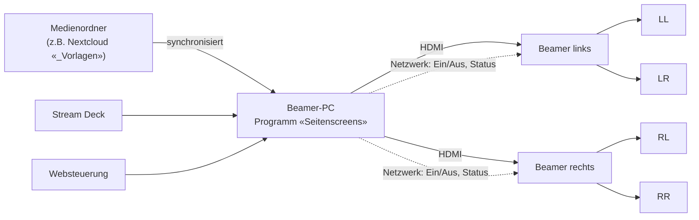
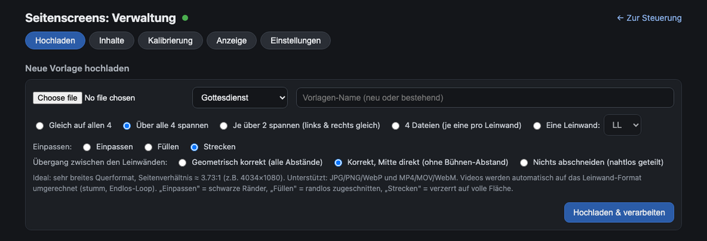
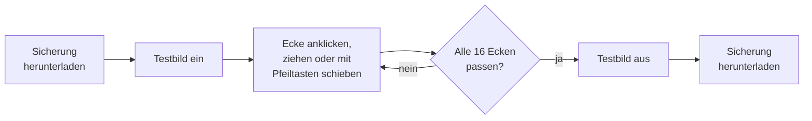
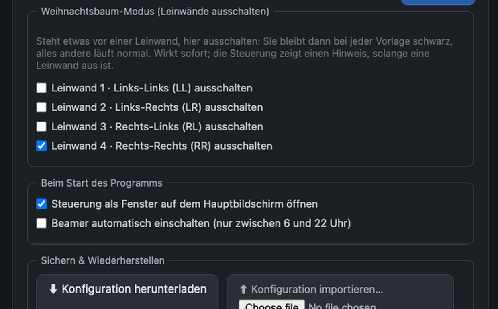
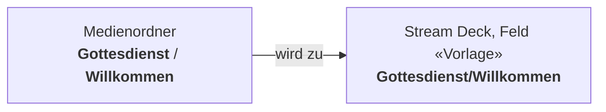
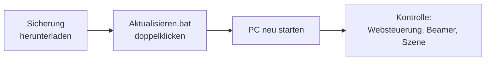

# Seitenscreens: Handbuch für die Technik

Für die Personen, die Seitenscreens betreuen: Hochladen, Kalibrierung,
Sicherung, Stream Deck und Updates. Die Bedienung im Alltag steht in der
[Kurzanleitung](KURZANLEITUNG.md), die Installation in
[INSTALLATION-KURZ.md](INSTALLATION-KURZ.md).

> **Bitte nur ändern, wenn man darum gebeten wurde oder weiss, was man tut.**
> Kalibrierung, Anzeige und Einstellungen wirken sofort und live auf den
> Leinwänden. Vor grösseren Änderungen zuerst eine Sicherung machen
> (Abschnitt 9).

## 1. So hängt alles zusammen

| Was | Wo |
|---|---|
| Programmordner | der Ordner, in den Seitenscreens installiert wurde, z.B. „Seitenscreens" auf dem Desktop des Beamer-PCs (Abschnitt 2) |
| Websteuerung | `http://<IP-Adresse des Beamer-PCs>:8080`, am Beamer-PC selbst auch `http://localhost:8080` |
| Verwaltung | in der Websteuerung oben rechts „Verwaltung →", oder direkt `…:8080/admin` |
| Inhalte | der Medienordner, z.B. ein Nextcloud-Ordner `_Vorlagen` (Pfad unter „Einstellungen") |
| Einstellungen und Kalibrierung | auf dem Beamer-PC unter `%APPDATA%\seitenscreens\config.json` (nicht im Programmordner) |
| Beamer | IP-Adressen unter „Einstellungen". Geschaltet wird über das Webinterface, der Status kommt per PJLink. |

Die IP-Adresse des Beamer-PCs sollte fest sein (im Router reservieren), sonst
finden Stream-Deck-Tasten und Lesezeichen die Steuerung nicht mehr.

## 2. Der Programmordner

Im Programmordner liegt das ganze Programm.

> **Diesen Ordner nicht verschieben, umbenennen oder löschen.** Der
> Autostart und die Desktop-Symbole zeigen auf ihn.

Wichtig sind nur die Skripte im Unterordner `scripts\windows`:

| Datei | Wozu |
|---|---|
| `Aktualisieren.bat` | neuen Programmstand holen (Abschnitt 12) |
| `Autostart einrichten.bat` / `Autostart entfernen.bat` | Programm bei der Windows-Anmeldung automatisch starten bzw. nicht mehr |
| `Desktop-Verknuepfung erstellen.bat` | Desktop-Symbol „Seitenscreens" neu anlegen |
| `Seitenscreens starten.bat` | Programm von Hand starten (macht auch das Desktop-Symbol) |

## 3. Die Verwaltung im Überblick

Websteuerung → oben rechts **„Verwaltung →"**. Die Reiter:

| Reiter | Wofür | Wer |
|---|---|---|
| **Hochladen** | Bilder und Videos einspielen (Abschnitt 4) | alle |
| **Inhalte** | Szenen und Einzelbilder löschen, „Neu rechnen" (Abschnitt 5) | Technik |
| **Kalibrierung** | Ecken der Leinwände ausrichten (Abschnitt 6) | nur Eingeweihte |
| **Anzeige** | welcher Beamer links/rechts ist, Vollbild (Abschnitt 7) | Technik |
| **Einstellungen** | Medienordner, Beamer, Wand-Masse, Weihnachtsbaum-Modus, Start-Optionen, Sicherung (Abschnitte 8–10) | nur Eingeweihte |

## 4. Hochladen im Detail

Für alles, was nicht genau als vier fertige Hochformat-Dateien vorliegt.
Das Programm schneidet, skaliert und rechnet Videos auf 30 Bilder pro Sekunde
um.

1. Verwaltung → **„Hochladen"**.
2. Datei wählen (Bild oder Video).
3. **Gruppe** (= Ordner im Medienordner, Reiter in der Steuerung) wählen oder
   „+ Neue Gruppe…".
4. **Vorlagen-Name** eingeben (= Name der Szene). Gibt es den Namen in dieser
   Gruppe schon, wird die Szene ersetzt (die Verwaltung weist darauf hin).
5. Optionen wählen (siehe unten). Die **Vorschau** unten zeigt sofort, wie es
   auf den vier Leinwänden aussieht.
6. **„Hochladen & verarbeiten"**. Bilder sind nach wenigen Sekunden da, Videos
   nach ein bis zwei Minuten (während ein Video live läuft, etwas länger).

**Am besten einfach ausprobieren:** Man kann jederzeit mit demselben Namen
neu hochladen, die alte Fassung wird dann ersetzt.

### Aufteilung

| Auswahl | Ergebnis | Gut für |
|---|---|---|
| **Über alle 4 spannen** (Standard) | Ein Bild/Video läuft über alle vier Leinwände | breite Motive, Panoramen, Hintergrundvideos |
| **Je über 2 spannen** | Dasselbe Motiv links über LL+LR und rechts über RL+RR | Querformat-Motive, die auf beiden Seiten gleich erscheinen sollen |
| **Gleich auf allen 4** | Dasselbe Bild viermal | Logos, einfache Hintergründe |
| **4 Dateien** | Für jede Leinwand eine eigene Datei, jede mit eigener Einpassung | vier verschiedene Bilder in einem Schritt |
| **Eine Leinwand** | Nur eine Leinwand bekommt die Datei | eine einzelne Leinwand ersetzen |

Bei **„Je über 2 spannen"** kann man die linke oder rechte Seite
**spiegeln**. Mit beiden Haken läuft eine Bewegung symmetrisch zur Mitte.

### Einpassen

| Auswahl | Was passiert |
|---|---|
| **Strecken** (Standard) | füllt die Fläche ganz, das Bild wird dafür etwas verzerrt |
| **Füllen** | füllt die Fläche ganz, ohne Verzerrung; was übersteht, wird abgeschnitten |
| **Einpassen** | das ganze Bild bleibt sichtbar, ohne Verzerrung; übrige Fläche schwarz |

### Übergang zwischen den Leinwänden (beim Spannen)

Zwischen den Leinwänden ist Wand. Diese Option bestimmt, wie das Programm
damit umgeht.

| Auswahl | Was passiert |
|---|---|
| **Korrekt, Mitte direkt** (Standard) | Links und rechts läuft das Motiv so weiter, als ginge es hinter der Wand durch (stimmt geometrisch). Über die grosse Lücke der Bühne geht es direkt weiter, sonst würde dort zu viel verloren gehen. |
| **Geometrisch korrekt (alle Abstände)** | Alle Lücken samt Bühne werden berücksichtigt. Durchgehende Linien fluchten genau, aber in der Mitte fehlt ein grosses Stück des Motivs. |
| **Nichts abschneiden (nahtlos geteilt)** | Das Motiv wird einfach in Stücke geteilt, nichts fällt weg. Schräge Linien haben an den Lücken einen Versatz. |

Die Abstände und Masse dafür stehen in den Einstellungen unter
„Wand-Layout" (Abschnitt 8).

### Loop glätten (nur Videos)

Blendet das Ende des Videos weich in den Anfang über. Nützlich, wenn ein
Video nicht nahtlos loopt und man sonst beim Neustart einen Sprung sieht. Das
Video wird dadurch um die Überblendung kürzer.

### Was gespeichert wird

Bei jeder hochgeladenen Szene legt das Programm im Szenen-Ordner zusätzlich
das **Original** ab (Unterordner `_original`, wird nicht angezeigt). Damit kann
es die Szene später neu rechnen, zum Beispiel nach einer neuen Kalibrierung
oder wenn die Abstände zwischen den Leinwänden neu gemessen wurden.

## 5. Inhalte, Papierkorb und Speicherplatz

Verwaltung → **„Inhalte"** zeigt alle Szenen und Einzelbilder.

- **„Papierkorb"** verschiebt eine Szene oder ein Einzelbild in den Ordner
  `_Papierkorb` im Medienordner. Nichts wird endgültig gelöscht.
  Wiederherstellen: aus `_Papierkorb` zurückschieben. Die gerade laufende
  Szene lässt sich nicht löschen.
- **„Neu rechnen"** erzeugt eine hochgeladene Szene aus ihrem Original neu.
- **„Alle Span-Vorlagen neu rechnen"** macht das für alle gespannten Szenen
  auf einmal, nötig nach geänderten Wand-Massen.

**Speicherplatz:** Wird er knapp, kann man den Inhalt von `_Papierkorb`
endgültig löschen. Die Originale in `_original` sollte man behalten, sonst
lassen sich diese Szenen nicht mehr neu rechnen.

## 6. Kalibrierung (Ecken ausrichten)

Nötig, wenn ein Beamer verschoben wurde und das Bild nicht mehr genau auf den
Leinwänden sitzt. Am besten zu zweit: eine Person am PC, eine schaut auf die
Leinwände.

1. **Sicherung** herunterladen (Abschnitt 9), damit man zurück kann.
2. Verwaltung → **„Kalibrierung"** → **„Testbild ein"**. Auf allen Leinwänden
   erscheint ein Raster mit dem Namen der Leinwand.
3. Für jeden Beamer gibt es ein Feld mit seinen zwei Leinwänden. Eine **Ecke
   anklicken** oder **ziehen**. Die gewählte Ecke leuchtet auf der echten
   Leinwand magenta, so sieht man, woran man gerade zieht.
4. **Feinjustieren** mit den Pfeiltasten: 1 Pixel, mit gedrückter Shift-Taste
   10 Pixel, mit Alt 0,1 Pixel. Mit dem **Zoom-Regler** sieht man die Ecke
   grösser.
5. Alle vier Ecken jeder Leinwand prüfen (zusammen 16), dann **„Testbild
   aus"**.
6. Nochmals eine **Sicherung** herunterladen. Das ist jetzt die neue gute
   Fassung.

Die Änderungen sind sofort gespeichert. Ist etwas schiefgegangen: die
Sicherung von Schritt 1 wieder einspielen.

> Weiss man nicht, welches Feld zu welchem Beamer gehört: erst unter
> „Anzeige" auf **„Fenster identifizieren"** drücken.

## 7. Anzeige (Beamer-Zuordnung)

Verwaltung → **„Anzeige"**:

| Knopf | Wann |
|---|---|
| **Fenster identifizieren** | blendet auf jedem Beamer 4 Sekunden gross „links"/„rechts" ein |
| **Links ↔ rechts tauschen** | wenn die Bilder der beiden Beamer vertauscht sind |
| **Vollbild erzwingen** | wenn ein Beamer-Bild nicht den ganzen Beamer füllt oder auf dem PC-Bildschirm landet |
| Auswahl **„Display / Ausgang"** | ordnet ein Fenster fest einem Ausgang zu (normalerweise nicht nötig) |
| **„Ausgabe um 180° drehen"** | nur für einen kopfüber montierten Beamer |

Der Haken „Hauptbildschirm (Bediener-Monitor) nie automatisch für einen
Beamer verwenden" bleibt an. Fehlt beim Start ein Beamer, wartet sein Fenster
und erscheint von selbst, sobald der Beamer da ist.

## 8. Einstellungen

| Feld | Bedeutung |
|---|---|
| Medienordner | Pfad zum Medienordner auf dem Beamer-PC. Nur ändern, wenn der Ordner umzieht. |
| Überblendung (ms) | wie weich zwischen zwei Szenen überblendet wird |
| Beamer links / rechts | IP-Adressen der Beamer. **„Verbindung testen"** prüft sie, ohne etwas zu schalten. |
| Standard-Gruppe | welcher Reiter beim Öffnen der Websteuerung vorgewählt ist |
| Wand-Layout | Breite und Höhe der Leinwände und die Abstände dazwischen in mm, dazu der Höhenversatz je Leinwand. Grundlage für „über alle 4 spannen". Nach einer Änderung: unter „Inhalte" „Alle Span-Vorlagen neu rechnen". |

Die Felder oben gelten erst nach **„Speichern"**. Die Abschnitte darunter
(Weihnachtsbaum-Modus, Beim Start) wirken sofort.

| Beim Start des Programms | Bedeutung |
|---|---|
| Steuerung als Fenster öffnen | öffnet beim Start die Websteuerung als Fenster auf dem PC-Bildschirm. So sieht man, dass das Programm läuft. |
| Beamer automatisch einschalten | schaltet beim Start die Beamer ein, wenn sie aus sind, aber nur zwischen 6 und 22 Uhr. Ein nächtlicher Neustart (z.B. Windows-Update) soll sie nicht anwerfen. |

## 9. Sichern und Wiederherstellen

Verwaltung → **„Einstellungen"** → „Sichern & Wiederherstellen":

- **„Konfiguration herunterladen"** sichert alles in eine Datei
  `seitenscreens-config.json`: Kalibrierung, Beamer-Zuordnung, Wand-Layout,
  alle Einstellungen. Ablegen z.B. im Medienordner unter `_Sicherung` (wird
  wegen `_` nicht als Szene angezeigt), am besten mit Datum im Namen.
- **„Konfiguration importieren…"** spielt eine solche Datei wieder ein und
  ersetzt damit die aktuelle Konfiguration. Ein Medienordner-Pfad, den es auf
  diesem PC nicht gibt, wird dabei nicht übernommen.

Sinnvoll nach jeder Kalibrierung, vor Änderungen an den Einstellungen und vor
jedem Update.

## 10. Weihnachtsbaum-Modus (einzelne Leinwände ausschalten)

Steht etwas vor einer Leinwand (z.B. ein Weihnachtsbaum), kann man sie
ausschalten. Sie bleibt dann bei jeder Szene schwarz, alles andere läuft
normal weiter. So muss man nicht in jede Szene ein schwarzes Bild einbauen.

1. Verwaltung → **„Einstellungen"** → Abschnitt **„Weihnachtsbaum-Modus"**.
2. Bei der betroffenen Leinwand den Haken setzen (1 = ganz links, 4 = ganz
   rechts). Wirkt sofort.
3. Solange eine Leinwand aus ist, zeigt die Websteuerung oben einen Hinweis,
   und in der Live-Zeile steht bei ihr „aus".

**Nicht vergessen:** Danach den Haken wieder entfernen.

## 11. Stream Deck

Seitenscreens bringt ein eigenes Stream-Deck-Plugin mit (Installation in
[STREAMDECK.md](STREAMDECK.md)). Seine Taste „Vorlage anwenden" zeigt eine
Vorschau der Szene und wendet sie beim Drücken an.

### Neue Szenen-Taste

Der Name im Feld „Vorlage" ist einfach der Weg zum Szenen-Ordner im
Medienordner:

1. Im Stream-Deck-Programm eine **bestehende Seitenscreens-Taste kopieren**
   (Rechtsklick → Kopieren, dann auf einem freien Feld Einfügen) oder die
   Aktion „Seitenscreens → Vorlage anwenden" auf ein Feld ziehen.
2. Unten bei den Einstellungen der Taste:
   - **Basis-URL des Beamer-PCs:** `http://<IP-Adresse des Beamer-PCs>:8080`
     (hängt das Stream Deck am Beamer-PC selbst, geht auch
     `http://localhost:8080`)
   - **Vorlage (Name oder Gruppe/Name):** `Gruppe/Szene`, genau wie die Ordner
     im Medienordner heissen, z.B. `Gottesdienst/Willkommen` oder
     `Hintergründe/Blau`
   - **„Beim Drücken die Vorlage anwenden"** angehakt lassen
3. Titel der Taste anpassen. Die Vorschau erscheint nach ein paar Sekunden.
   Bleibt die Taste leer, stimmt der Name nicht.

### Andere Tasten

Für Blackout oder die Beamer eignet sich **System → Website** mit Haken
**„GET-Anfrage im Hintergrund"** (`<PC>` = IP-Adresse des Beamer-PCs):

| Taste | URL |
|---|---|
| Blackout ein/aus | `http://<PC>:8080/api/blackout/toggle` |
| Beide Beamer ein | `http://<PC>:8080/api/projector/on` |
| Beide Beamer aus | `http://<PC>:8080/api/projector/off` |
| Websteuerung öffnen | `http://<PC>:8080` (ohne Haken, öffnet den Browser) |

**Nach Änderungen** das Profil exportieren und sichern (Stream-Deck-Programm →
Profil → Exportieren), z.B. im Medienordner unter `_Sicherung`.

## 12. Wartung und Update

| Aufgabe | Wie |
|---|---|
| Programm von Hand starten | Desktop-Symbol „Seitenscreens". Läuft es schon, kommt nur das Steuerungsfenster nach vorne. |
| Programm hängt | PC neu starten, oder im Task-Manager „Electron" beenden und das Desktop-Symbol starten |
| Autostart ein/aus | `scripts\windows\Autostart einrichten.bat` bzw. `Autostart entfernen.bat` |

### Programm aktualisieren

> **Nur durch die verantwortliche Person oder auf deren Anweisung.** Nie
> während eines Gottesdienstes oder einer Veranstaltung.

1. **Sicherung** herunterladen (Abschnitt 9).
2. Im Programmordner `scripts` → `windows` → Doppelklick auf
   **`Aktualisieren.bat`**. Das Skript holt den neusten Stand von GitHub (per
   `git pull` oder als ZIP). Am Schluss mit einer beliebigen Taste schliessen.
3. **PC neu starten.** Beim Start baut sich das Programm selbst neu (dauert
   einmalig etwas länger).
4. **Kontrolle:** Websteuerung öffnet sich, Beamer-Status stimmt, eine Szene
   anwenden.

Einstellungen, Kalibrierung und Beamer-Zuordnung bleiben beim Update erhalten
(sie liegen ausserhalb des Programmordners). Meldet das Skript einen roten
Fehler: Text abfotografieren und der verantwortlichen Person schicken. Das
Programm läuft dann einfach mit dem bisherigen Stand weiter.

### Für einen reibungslosen Betrieb

- Liegt der Medienordner in der Nextcloud: auf dem Beamer-PC **„Immer auf
  diesem Gerät behalten"** einstellen, damit alle Videos lokal vorliegen.
- Windows-Energieoptionen: Bildschirm ausschalten und Energiesparmodus auf
  **„Nie"**, sonst werden die Leinwände irgendwann schwarz.
- Die IP-Adresse des Beamer-PCs fest vergeben (im Router reservieren).
